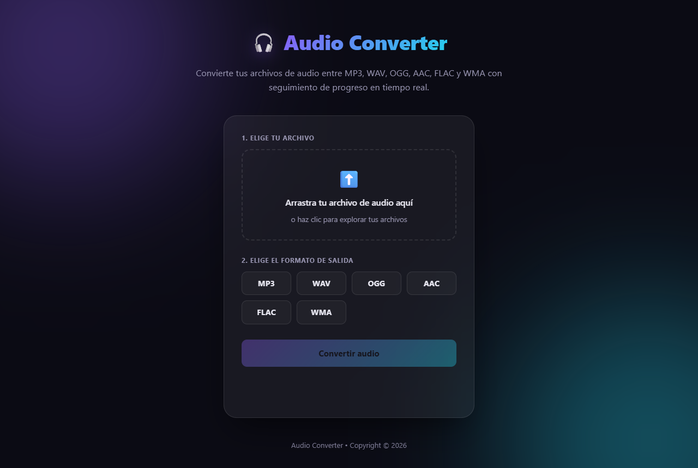
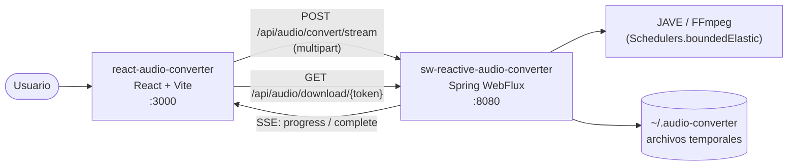
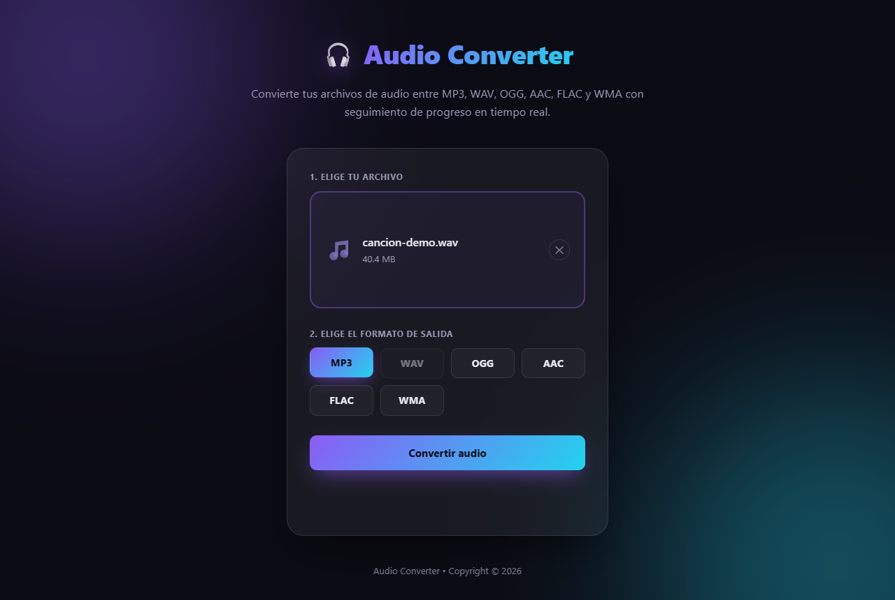
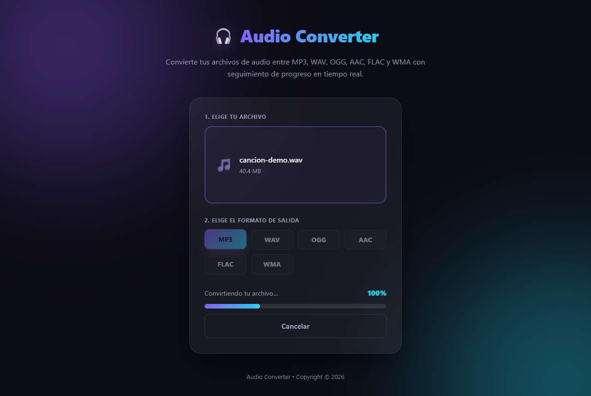
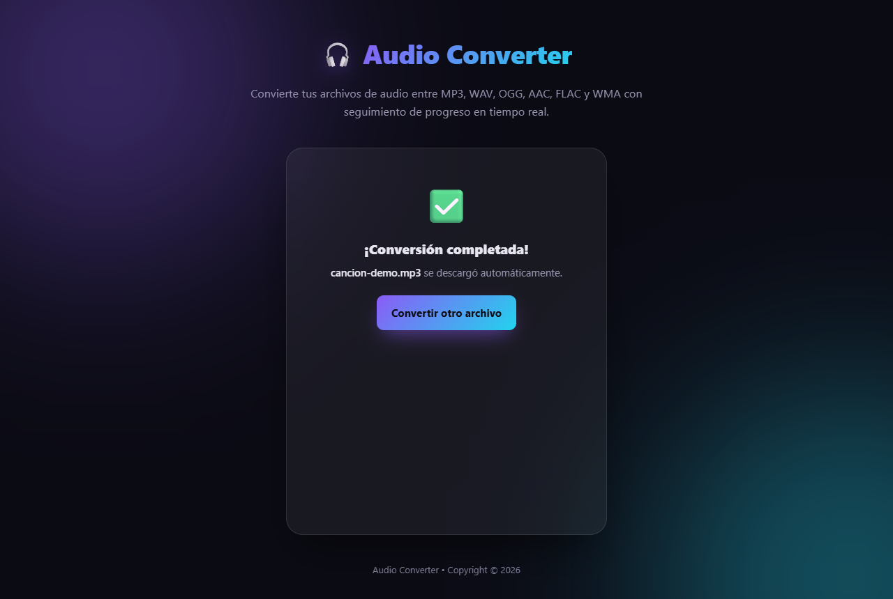
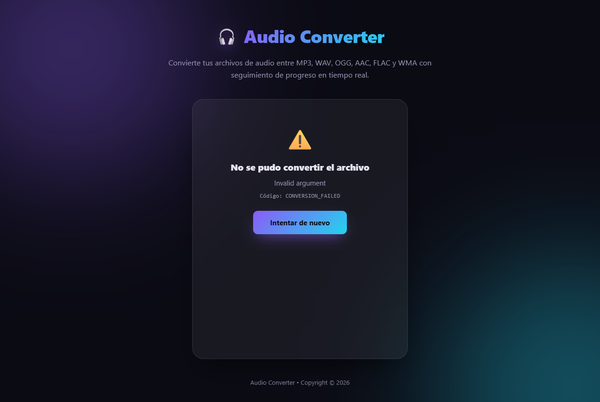
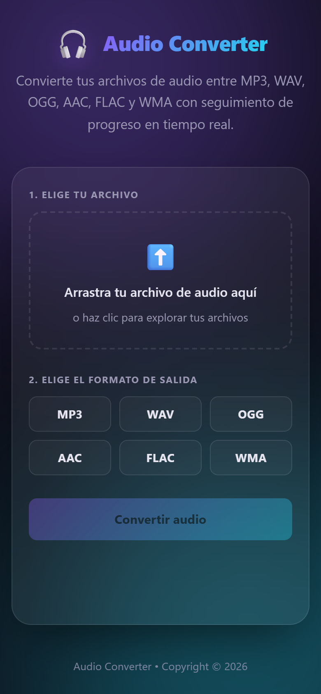
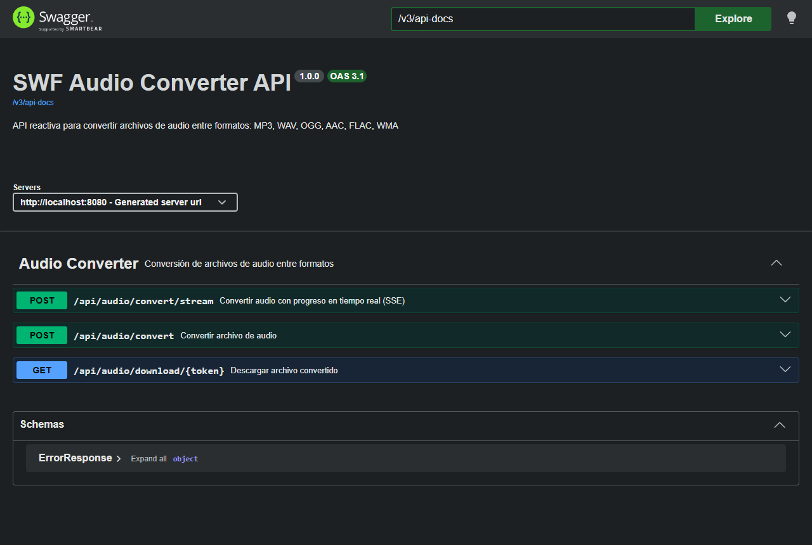

# Audio Converter

Aplicación full-stack para convertir archivos de audio entre **MP3, WAV, OGG, AAC, FLAC y WMA**, con seguimiento del progreso en tiempo real.



El repositorio contiene dos proyectos:

| Proyecto | Descripción | Stack | Puerto |
|---|---|---|---|
| [`sw-reactive-audio-converter`](sw-reactive-audio-converter/README.md) | API REST reactiva que realiza la conversión y emite el progreso por SSE | Java 17, Spring Boot 4.1 (WebFlux), JAVE 3.5 (FFmpeg), springdoc-openapi | `8080` |
| [`react-audio-converter`](react-audio-converter/README.md) | Interfaz web para subir el archivo, elegir el formato y descargar el resultado | React 19, TypeScript 6, Vite 8 | `3000` |

## Arquitectura



1. El frontend envía el archivo y el formato destino a `POST /api/audio/convert/stream`.
2. El backend guarda el archivo en un directorio temporal y lo convierte con JAVE (FFmpeg embebido), fuera del event loop, en `Schedulers.boundedElastic()`.
3. Mientras convierte, emite eventos SSE `progress` (`{ "progress": 0-100 }`) cada ~500 ms.
4. Al terminar emite `complete` con `{ filename, downloadToken }`.
5. El frontend descarga el archivo con `GET /api/audio/download/{token}` (token de un solo uso) y lo guarda automáticamente.

También existe `POST /api/audio/convert`, que devuelve el archivo convertido directamente sin streaming de progreso (útil con `curl`).

## Inicio rápido con Docker

Requisitos: Docker y Docker Compose.

```bash
docker compose up -d --build
```

| Servicio | URL |
|---|---|
| Aplicación web | http://localhost:3000 |
| API | http://localhost:8080 |
| Swagger UI | http://localhost:8080/swagger-ui.html |
| OpenAPI JSON | http://localhost:8080/v3/api-docs |

Para detenerlo:

```bash
docker compose down
```

> **Nota:** el navegador llama al backend usando `VITE_API_BASE_URL`, que se toma de `react-audio-converter/.env` (`http://localhost:8080`) en tiempo de build. El argumento `VITE_API_BASE_URL` declarado en `docker-compose.yml` no tiene efecto porque el `Dockerfile` del frontend no declara un `ARG` con ese nombre (y, de tenerlo, `http://sw-audio-backend:8080` no sería resoluble desde el navegador).

## Ejecución local (sin Docker)

**Backend** (Java 17+, Maven 3.8+):

```bash
cd sw-reactive-audio-converter
mvn spring-boot:run
```

**Frontend** (Node.js 20+):

```bash
cd react-audio-converter
npm install
npm run dev     # http://localhost:5173
```

## Capturas de pantalla

### Flujo de conversión

| 1. Pantalla inicial | 2. Archivo y formato seleccionados |
|---|---|
|  |  |

| 3. Conversión en curso | 4. Conversión completada |
|---|---|
|  |  |

### Manejo de errores

Al subir un archivo que no es audio válido, el backend responde con `422 CONVERSION_FAILED` y la interfaz muestra el mensaje y el código de error:



### Vista móvil



### Documentación de la API (Swagger UI)



## Estructura del repositorio

```
audio_converter/
├── docker-compose.yml               # Orquesta backend (8080) y frontend (3000)
├── docs/
│   └── screenshots/                 # Capturas usadas en los README
├── react-audio-converter/           # Frontend React + Vite
└── sw-reactive-audio-converter/     # Backend Spring Boot WebFlux
```

## Licencia

Distribuido bajo la licencia MIT. Ver [LICENSE](LICENSE).
