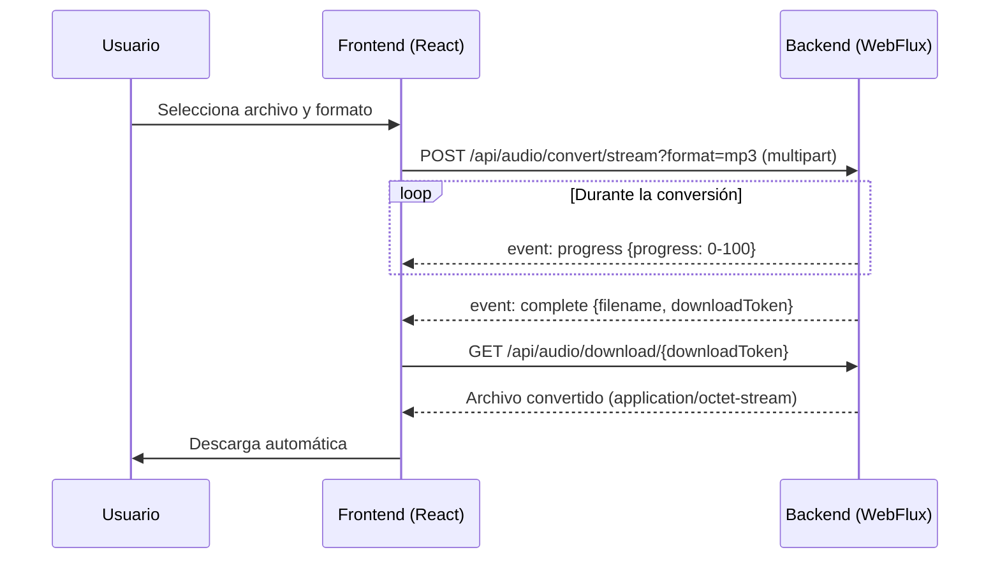

# React Audio Converter

Interfaz web construida con **React 19 + TypeScript + Vite** para convertir archivos de audio entre formatos. Consume la API reactiva [`sw-reactive-audio-converter`](../sw-reactive-audio-converter) y muestra el progreso de la conversión en tiempo real mediante **Server-Sent Events (SSE)**.


## Características

- Selección de archivo con **arrastrar y soltar** o explorador de archivos (accesible con teclado).
- Selección del formato de salida: `MP3` · `WAV` · `OGG` · `AAC` · `FLAC` · `WMA`.
- Deshabilita automáticamente el formato de origen (no se puede convertir un `.mp3` a MP3).
- Barra de progreso en tiempo real alimentada por SSE.
- Cancelación de la conversión en curso (`AbortController`).
- Descarga automática del archivo convertido al terminar.
- Manejo de errores con el mensaje y el código devueltos por la API.
- Diseño responsivo (escritorio y móvil).

## Stack tecnológico

| Tecnología | Versión |
|---|---|
| React / React DOM | 19.2 |
| TypeScript | 6.0 |
| Vite | 8.1 |
| @vitejs/plugin-react | 6.0 |
| Oxlint | 1.72 |
| Node.js (imagen Docker) | 26 (alpine) |

No usa librerías de UI ni de estado externas: todo el estilo está en CSS plano (`App.css`, `index.css`).

## Estructura del proyecto

```
react-audio-converter/
├── public/                     # favicon e íconos
├── src/
│   ├── api/
│   │   └── audioApi.ts         # Cliente HTTP: conversión con SSE, descarga y errores
│   ├── components/
│   │   ├── AudioConverterCard.tsx  # Orquesta el flujo (archivo → formato → conversión)
│   │   ├── FileDropZone.tsx        # Zona de arrastrar y soltar
│   │   ├── FormatPicker.tsx        # Selector de formato de salida
│   │   ├── ProgressPanel.tsx       # Barra de progreso + botón cancelar
│   │   └── ResultPanel.tsx         # Paneles de éxito y error
│   ├── hooks/
│   │   └── useAudioConverter.ts    # Estado de la conversión (idle/converting/success/error)
│   ├── App.tsx / App.css       # Layout de la página
│   ├── index.css               # Estilos globales
│   └── main.tsx                # Punto de entrada
├── .env                        # VITE_API_BASE_URL
├── Dockerfile                  # Build multi-etapa servido con `serve`
├── nginx.conf                  # Configuración alternativa para servir con Nginx (no usada por el Dockerfile)
└── vite.config.ts
```

## Cómo funciona



- La API nativa `EventSource` no permite enviar un `POST` con cuerpo multipart, por eso `audioApi.ts` usa `fetch` + `ReadableStream` y parsea manualmente los eventos SSE (`event:` / `data:` separados por línea en blanco).
- El `downloadToken` es de **un solo uso**: el backend elimina la referencia tras la primera descarga.
- Si la respuesta no es `2xx`, el cuerpo `{ errorCode, message, timestamp }` se transforma en un `ApiError` que se muestra en el panel de error. Los fallos de red se reportan con el código `NETWORK_ERROR`.

## Configuración

| Variable | Descripción | Valor por defecto |
|---|---|---|
| `VITE_API_BASE_URL` | URL base del backend, vista **desde el navegador** | `http://localhost:8080` |

Se define en el archivo `.env`. Al ser una variable de Vite, su valor se **incrusta en el bundle en tiempo de build**, por lo que cambiarla requiere recompilar.

> El backend sólo acepta CORS desde orígenes `http://localhost:*`. Si el frontend se sirve desde otro dominio hay que ajustar `CorsConfig` en el backend.

## Requisitos

- Node.js 20+ y npm
- El backend corriendo en `http://localhost:8080` (o la URL configurada en `VITE_API_BASE_URL`)

## Ejecución en desarrollo

```bash
npm install
npm run dev
```

La aplicación queda disponible en `http://localhost:5173`.

## Scripts

| Comando | Descripción |
|---|---|
| `npm run dev` | Servidor de desarrollo con HMR |
| `npm run build` | Verificación de tipos (`tsc -b`) y build de producción en `dist/` |
| `npm run preview` | Sirve localmente el build de producción |
| `npm run lint` | Ejecuta Oxlint |

## Docker

El `Dockerfile` hace un build multi-etapa: compila la app con Node y sirve `dist/` con [`serve`](https://www.npmjs.com/package/serve) en el puerto **3000**.

```bash
docker build -t react-audio-converter .
docker run -p 3000:3000 react-audio-converter
```

Para levantar frontend y backend juntos, usa el `docker-compose.yml` de la [raíz del repositorio](../README.md).

## Capturas de pantalla

| Archivo y formato seleccionados | Conversión completada | Error de conversión |
|---|---|---|
|  |  |  |
