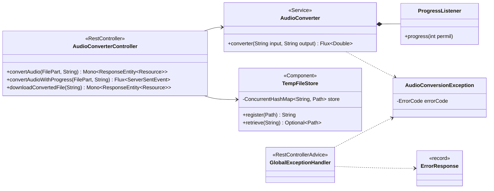
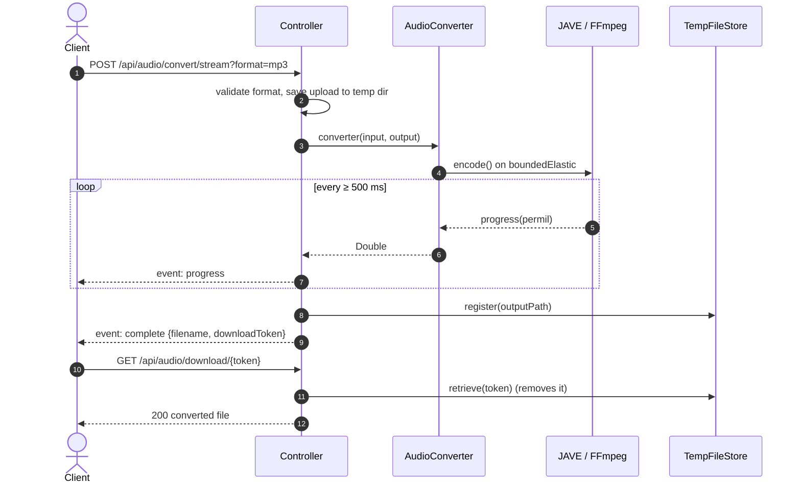

# SW Reactive Audio Converter

A reactive REST API built with **Spring Boot WebFlux** for converting audio files between formats. Conversion runs on an embedded FFmpeg (via JAVE) and progress is streamed in real time with **Server-Sent Events (SSE)**.

It is the backend of the [Audio Converter](../README.md) project; the web UI lives in [`react-audio-converter`](../react-audio-converter/README.md).


## Tech Stack

| Technology | Version |
|---|---|
| Java | 17 |
| Spring Boot | 4.1.0 |
| Spring WebFlux / Project Reactor | via Spring Boot |
| Spring Boot Actuator | via Spring Boot |
| JAVE — Java Audio Video Encoder (`jave-all-deps`, embedded FFmpeg) | 3.5.0 |
| springdoc-openapi WebFlux UI | 3.0.3 |
| Lombok | via Spring Boot |
| JUnit 5 + Mockito + `WebTestClient` | via Spring Boot |

## Supported Formats

| Format | Codec | Bit rate | Channels / Sample rate |
|---|---|---|---|
| `mp3` | `libmp3lame` | 128 kbps | 2 ch · 44.1 kHz |
| `wav` | `pcm_s16le` | lossless | 2 ch · 44.1 kHz |
| `ogg` | `libvorbis` | 128 kbps | 2 ch · 44.1 kHz |
| `aac` | `aac` | 128 kbps | 2 ch · 44.1 kHz |
| `flac` | `flac` | lossless | 2 ch · 44.1 kHz |
| `wma` | `wmav2` | 128 kbps | 2 ch · 44.1 kHz |

The `format` parameter is case-insensitive and trimmed (`" MP3 "` is accepted).

## Project Structure

```
sw-reactive-audio-converter/
├── src/main/java/com/work/converter/
│   ├── SwfReactiveConverterApplication.java   # Spring Boot entry point
│   ├── config/
│   │   ├── CorsConfig.java                    # CORS for /api/** (http://localhost:*)
│   │   └── OpenApiConfig.java                 # OpenAPI metadata
│   ├── controller/
│   │   └── AudioConverterController.java      # /api/audio endpoints
│   ├── exception/
│   │   ├── AudioConversionException.java      # Domain exception + ErrorCode enum
│   │   ├── ErrorResponse.java                 # Error body (record)
│   │   └── handler/
│   │       └── GlobalExceptionHandler.java    # Maps exceptions → HTTP status
│   └── service/
│       ├── AudioConverter.java                # JAVE encoding + progress Flux
│       └── TempFileStore.java                 # Single-use download tokens
├── src/main/resources/application.properties
├── src/test/java/...                          # Controller, exception and handler tests
├── docs/DIAGRAMS.md                           # UML and architecture diagrams
├── Dockerfile                                 # Multi-stage build (Maven → Corretto 17 Alpine)
├── run.sh                                     # Container entrypoint (accepts JAVA_OPTS)
└── pom.xml
```

## Architecture





The full set of diagrams — complete UML class diagram, component diagram, sequence diagrams for every endpoint, conversion activity, token lifecycle, error handling and Docker deployment — is in **[docs/DIAGRAMS.md](docs/DIAGRAMS.md)**.

### Design notes

- **Non-blocking I/O**: every endpoint returns `Mono` or `Flux`. Blocking work (temp directory creation, JAVE encoding, token lookup) is offloaded to `Schedulers.boundedElastic()`.
- **Progress as a `Flux`**: `AudioConverter` bridges JAVE's callback-based `EncoderProgressListener` into a `Flux<Double>` with `Flux.create`, throttled to one value every 500 ms (plus the final 100%).
- **Secure temp files**: uploads and outputs are stored under `~/.audio-converter/audio-converter-*` instead of a publicly writable directory (SonarQube S5443).
- **Single-use download tokens**: `TempFileStore` maps a random UUID to the output path in a `ConcurrentHashMap`; `retrieve` removes the entry, so a token works only once.
- **Consistent errors**: `GlobalExceptionHandler` turns every exception into an `ErrorResponse`; unexpected exceptions return a generic message without leaking internals.

## API Endpoints

| Method | Path | Description |
|---|---|---|
| `POST` | `/api/audio/convert` | Convert and return the file directly |
| `POST` | `/api/audio/convert/stream` | Convert and stream progress via SSE |
| `GET` | `/api/audio/download/{token}` | Download the result of a streamed conversion |

### `POST /api/audio/convert`

Converts an audio file and returns it as a direct binary download.

**Request** — `multipart/form-data`

| Parameter | Type | Description |
|---|---|---|
| `file` | File (part) | Audio file to convert |
| `format` | String (form field or query param) | Target format (`mp3`, `wav`, `ogg`, `aac`, `flac`, `wma`) |

**Response** — `200 OK`, `application/octet-stream`, with `Content-Disposition: attachment; filename="<name>.<format>"`.

---

### `POST /api/audio/convert/stream`

Converts an audio file and streams real-time progress via SSE.

**Request** — `multipart/form-data` with the `file` part and `format` as a query parameter.

**Response** — `text/event-stream`

```
event:progress
data:{"progress":25.4}

event:progress
data:{"progress":75.0}

event:complete
data:{"filename":"audio.wav","downloadToken":"550e8400-e29b-41d4-a716-446655440000"}
```

Once the `complete` event is received, use the `downloadToken` to retrieve the file.

> The browser `EventSource` API only supports `GET`, so clients must read this stream with `fetch` + `ReadableStream` (see the example below).

---

### `GET /api/audio/download/{token}`

Downloads the converted file using the token from the SSE `complete` event.

> Tokens are **single-use** — the token is removed from the store on the first download. Reusing it returns `500 FILE_PROCESSING_ERROR`.

**Response** — `200 OK`, `application/octet-stream`.

## Error Responses

All errors follow this structure:

```json
{
  "errorCode": "CONVERSION_FAILED",
  "message": "Descriptive error message",
  "timestamp": "2026-10-22T10:15:30"
}
```

| HTTP Status | Error Code | Cause |
|---|---|---|
| `400` | `INVALID_FORMAT` | Unsupported target format |
| `422` | `CONVERSION_FAILED` | Encoder failed, or the uploaded file is not valid audio |
| `500` | `FILE_PROCESSING_ERROR` | Error creating temp dir / saving the upload, or invalid / already used download token |
| `500` | `INTERNAL_ERROR` | Unexpected server error (generic message) |

## Configuration

| Setting | Where | Value |
|---|---|---|
| Server port | Spring Boot default | `8080` |
| CORS | `CorsConfig` | `/api/**`, origins `http://localhost:*`, methods `GET POST PUT DELETE OPTIONS`, exposes `Content-Disposition`, credentials allowed |
| Temp directory | `AudioConverterController` | `${user.home}/.audio-converter/` |
| Progress throttle | `AudioConverter.ProgressListener` | 500 ms |
| JVM options (Docker) | `JAVA_OPTS` env var read by `run.sh` | empty |
| Time zone (Docker) | `TZ` in `Dockerfile` | `America/Mexico_City` |

To serve the frontend from a domain other than `localhost`, add its origin in `CorsConfig`.

## Getting Started

### Prerequisites

- Java 17+
- Maven 3.8+

FFmpeg does **not** need to be installed: `jave-all-deps` ships native binaries for Windows, Linux and macOS.

### Run

```bash
mvn spring-boot:run
```

### Build

```bash
mvn clean package
java -jar target/sw-reactive-audio-converter-1.0.0.jar
```

### Docker

The `Dockerfile` builds with `maven:3.9.7-amazoncorretto-17` (tests skipped) and runs on `amazoncorretto:17-alpine` through `run.sh`.

```bash
docker build -t sw-reactive-audio-converter .
docker run -p 8080:8080 -e JAVA_OPTS="-Xmx512m" sw-reactive-audio-converter
```

To run it together with the frontend, use the `docker-compose.yml` at the [repository root](../README.md).

### API Documentation

| Resource | URL |
|---|---|
| Swagger UI | http://localhost:8080/swagger-ui.html |
| OpenAPI JSON | http://localhost:8080/v3/api-docs |
| Health check (Actuator) | http://localhost:8080/actuator/health |

## Usage Examples

### Convert directly (curl)

```bash
curl -X POST http://localhost:8080/api/audio/convert \
  -F "file=@song.mp3" \
  -F "format=wav" \
  --output song.wav
```

### Stream progress (curl)

```bash
curl -N -X POST "http://localhost:8080/api/audio/convert/stream?format=ogg" \
  -F "file=@song.mp3"

# then, with the token from the "complete" event:
curl -OJ http://localhost:8080/api/audio/download/<downloadToken>
```

### Stream progress (JavaScript)

```javascript
const formData = new FormData();
formData.append('file', audioFile);

const response = await fetch('http://localhost:8080/api/audio/convert/stream?format=wav', {
  method: 'POST',
  body: formData,
});

const reader = response.body.getReader();
const decoder = new TextDecoder();
let buffer = '';

while (true) {
  const { done, value } = await reader.read();
  if (done) break;
  buffer += decoder.decode(value, { stream: true });

  const events = buffer.split('\n\n');
  buffer = events.pop(); // keep the incomplete event for the next chunk

  for (const raw of events) {
    const event = raw.match(/^event:(.*)$/m)?.[1].trim();
    const data = JSON.parse(raw.match(/^data:(.*)$/m)[1]);

    if (event === 'complete') {
      window.location.href = `http://localhost:8080/api/audio/download/${data.downloadToken}`;
    } else {
      console.log(`Progress: ${data.progress}%`);
    }
  }
}
```

## Running Tests

```bash
mvn test
```

Tests use `WebTestClient.bindToController()` with Mockito — no application context is started.

| Test class | Covers |
|---|---|
| `AudioConverterControllerTest` | 400 for unsupported formats, 422 on conversion failure, 200 with file, case-insensitive format, 500 on unexpected errors, paths passed to the converter, SSE `progress`/`complete` events and error propagation |
| `GlobalExceptionHandlerTest` | Status mapping for each `ErrorCode`, non-null bodies, generic 500 without internal details |
| `AudioConversionExceptionTest` | Constructors, cause and `ErrorCode` values |

## Known Limitations

- **Temp files are not cleaned up**: input and output files stay in `~/.audio-converter/` after the download; consuming a token only removes the map entry.
- **Tokens are in memory**: pending download tokens are lost when the application restarts and are not shared between instances.
- **Unused tokens never expire**: if a client never downloads the file, its entry stays in `TempFileStore`.
- **Errors after streaming starts**: once the first `progress` event has been sent, a later failure cannot change the HTTP status; the stream simply ends without a `complete` event.
- **No upload size limit** is configured beyond Spring's defaults.
