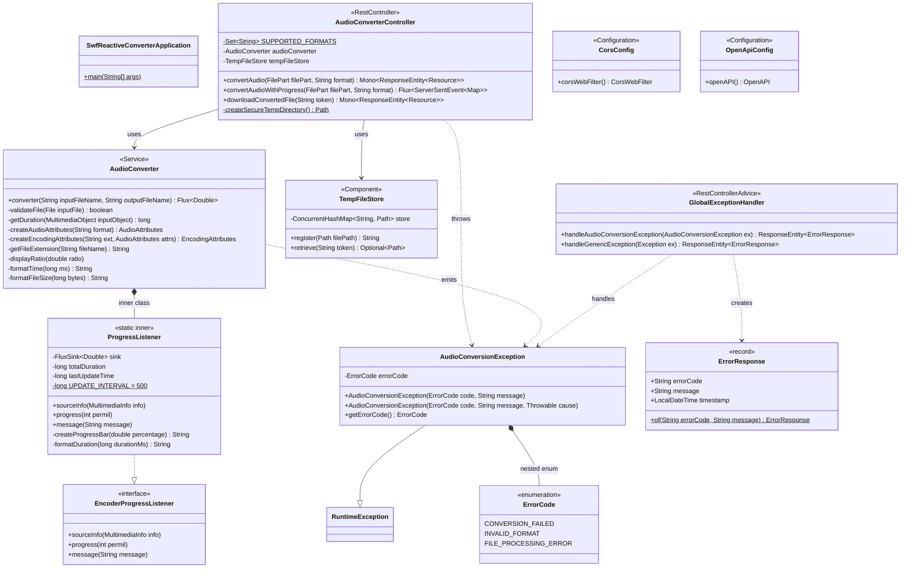
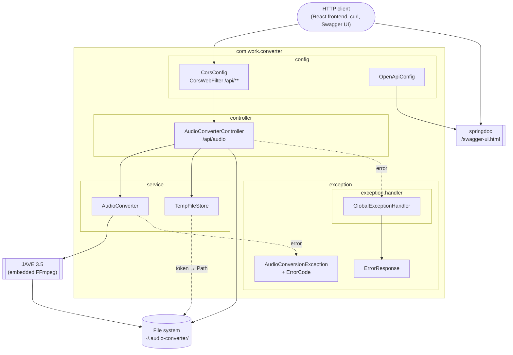
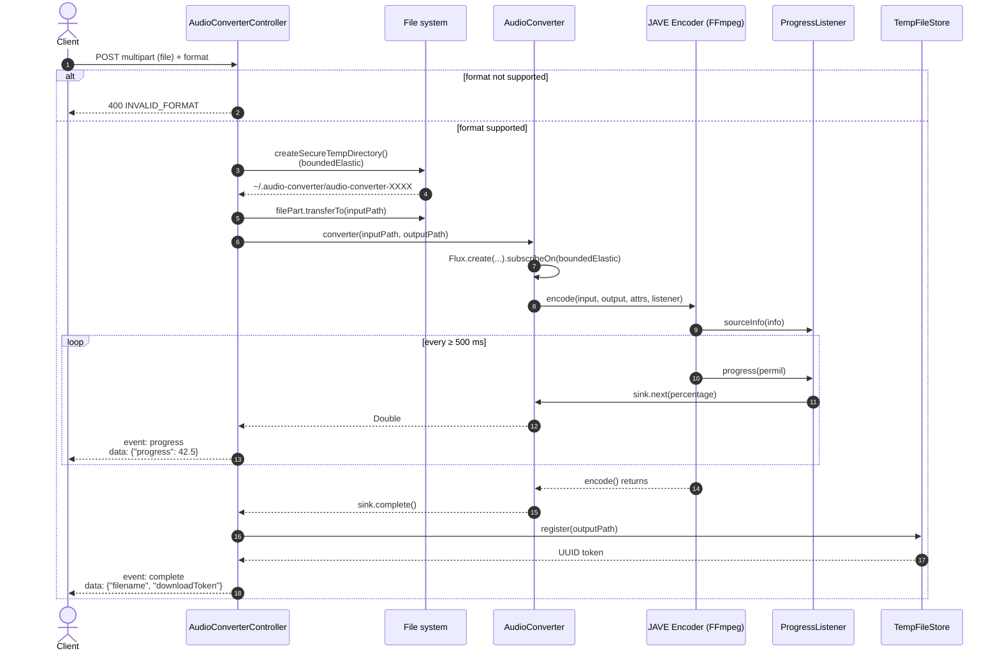
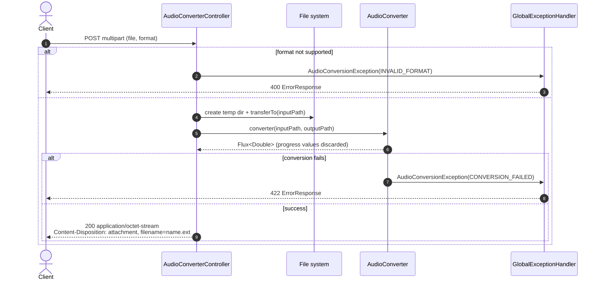
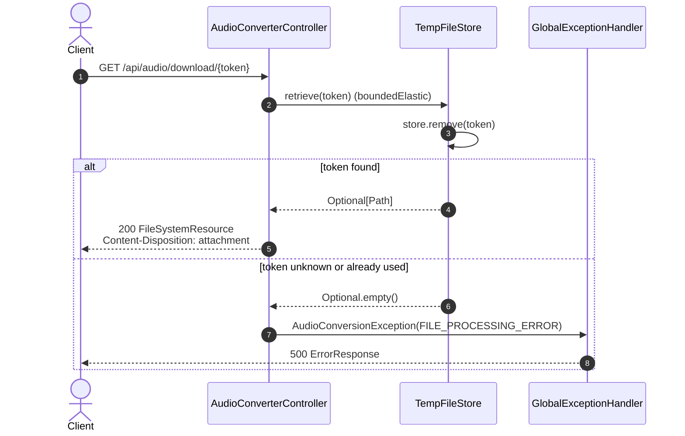
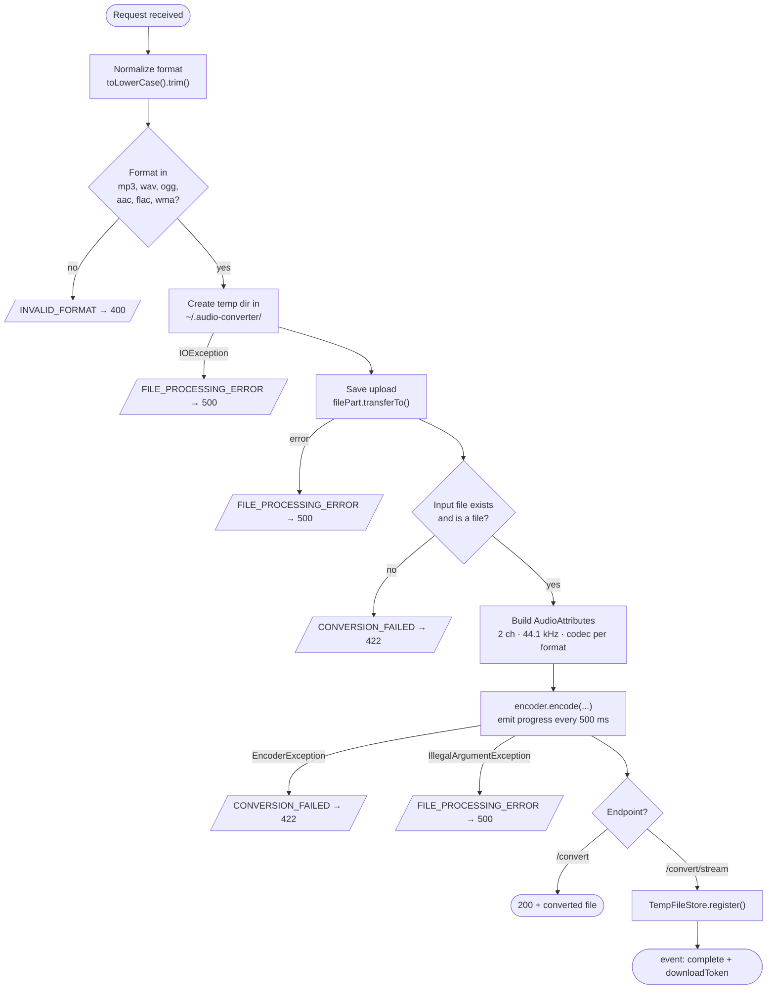
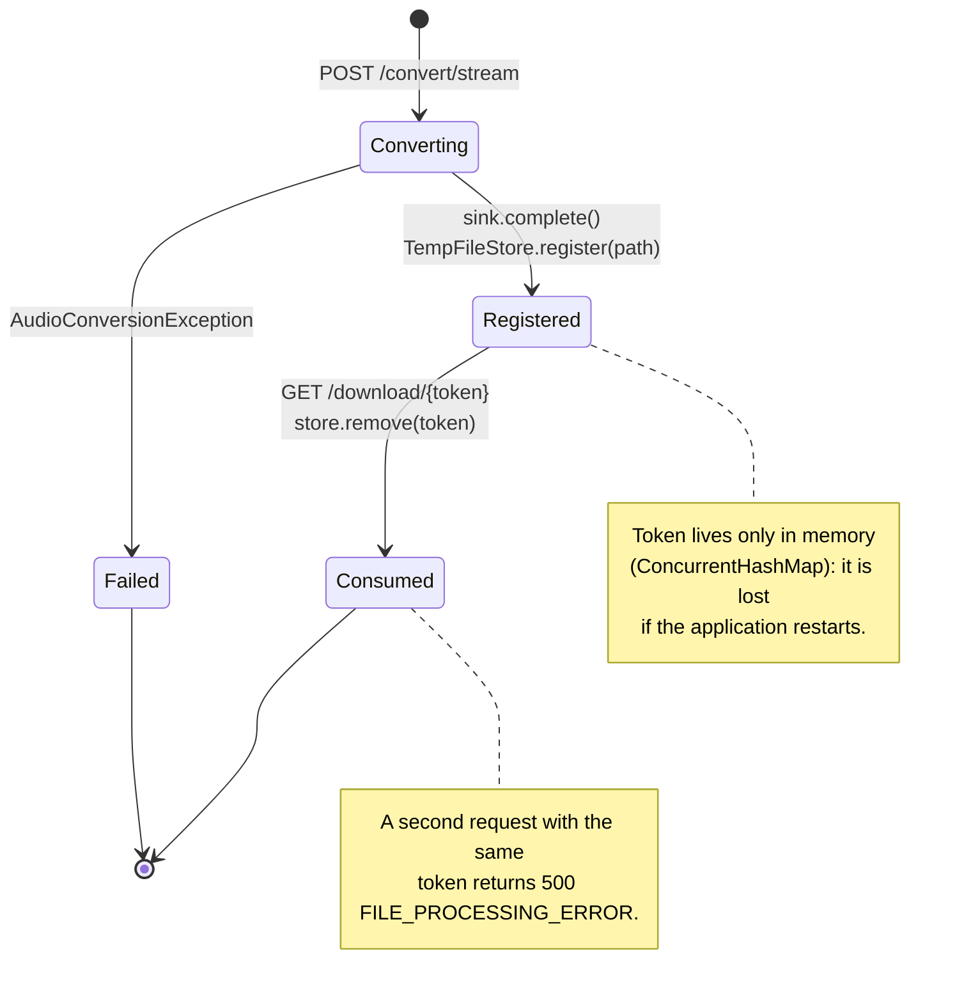
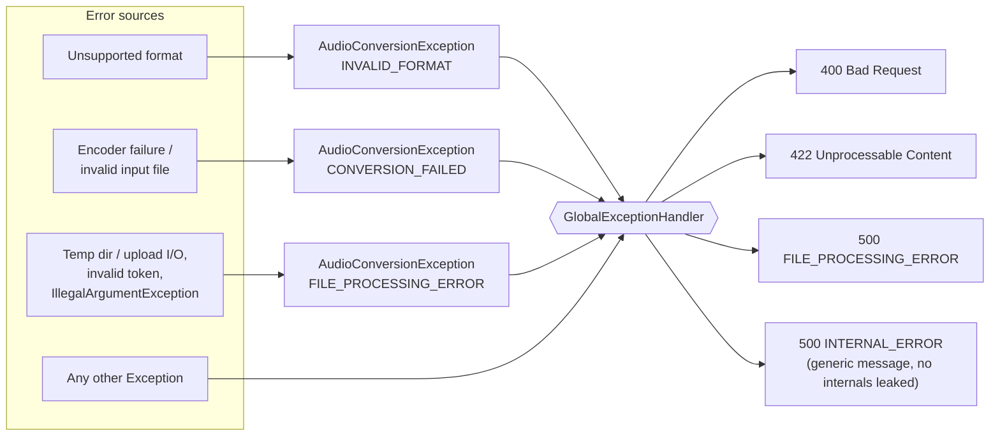
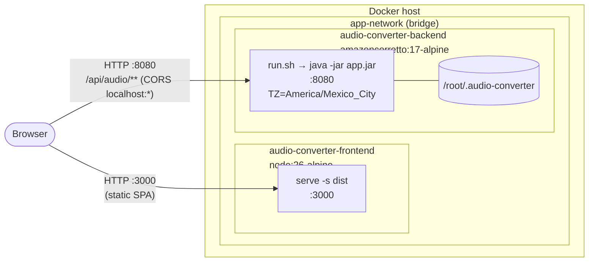

# SW Reactive Audio Converter — Diagrams

All diagrams are written in [Mermaid](https://mermaid.js.org/) and render natively on GitHub, GitLab and in most IDE Markdown previews.

- [1. UML Class Diagram](#1-uml-class-diagram)
- [2. Component / Package Diagram](#2-component--package-diagram)
- [3. Sequence — Conversion with SSE progress](#3-sequence--conversion-with-sse-progress)
- [4. Sequence — Direct conversion](#4-sequence--direct-conversion)
- [5. Sequence — Download by token](#5-sequence--download-by-token)
- [6. Activity — Conversion pipeline](#6-activity--conversion-pipeline)
- [7. State — Download token lifecycle](#7-state--download-token-lifecycle)
- [8. Error handling](#8-error-handling)
- [9. Deployment Diagram](#9-deployment-diagram)

---

## 1. UML Class Diagram

---

## 2. Component / Package Diagram

---

## 3. Sequence — Conversion with SSE progress

`POST /api/audio/convert/stream?format={format}`

---

## 4. Sequence — Direct conversion

`POST /api/audio/convert` (`file` + `format` in the multipart body / query)

---

## 5. Sequence — Download by token

`GET /api/audio/download/{token}`

---

## 6. Activity — Conversion pipeline

Codec settings applied by `AudioConverter.createAudioAttributes`:

| Format | Codec | Bit rate | Channels | Sample rate |
|---|---|---|---|---|
| `mp3` | `libmp3lame` | 128 kbps | 2 | 44 100 Hz |
| `wav` | `pcm_s16le` | — (lossless) | 2 | 44 100 Hz |
| `ogg` | `libvorbis` | 128 kbps | 2 | 44 100 Hz |
| `aac` | `aac` | 128 kbps | 2 | 44 100 Hz |
| `flac` | `flac` | — (lossless) | 2 | 44 100 Hz |
| `wma` | `wmav2` | 128 kbps | 2 | 44 100 Hz |

---

## 7. State — Download token lifecycle

---

## 8. Error handling

Every response body has the `ErrorResponse` shape: `{ "errorCode", "message", "timestamp" }`.

---

## 9. Deployment Diagram

